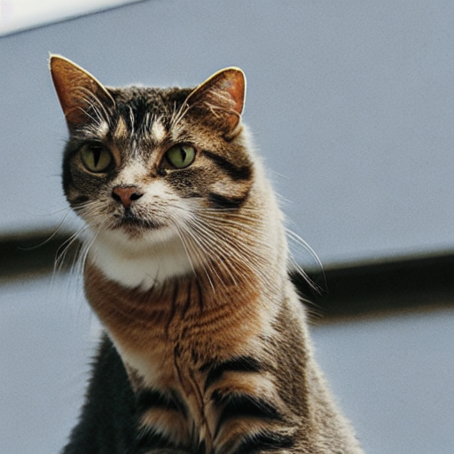
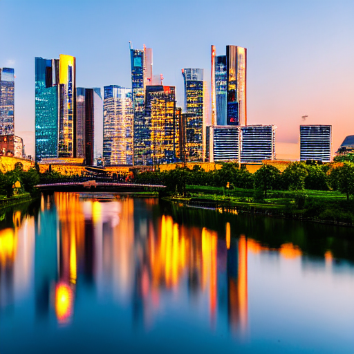
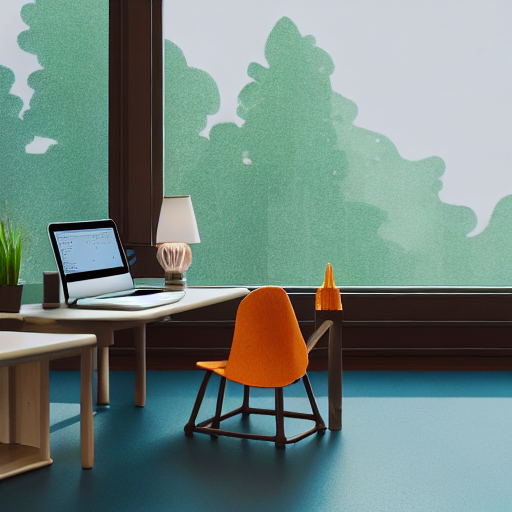

# ДЗ 7 — Stable Diffusion
Модель: `stable-diffusion-v1-5/stable-diffusion-v1-5` (локально, CPU), 512x512, steps=25, guidance_scale=7.5, seed=42

## 01_simple_cat — простой промпт
**Prompt:** a cat sitting on a roof
**Negative prompt:** —

## 02_medium_frankfurt — средний промпт
**Prompt:** Frankfurt am Main skyline at golden hour, view from the Main river, reflections on the water, cinematic, highly detailed
**Negative prompt:** blurry, low quality, deformed, bad anatomy, extra fingers, watermark, text, signature

## 03_complex_robot_dev — сложный промпт
**Prompt:** a small friendly robot programmer sitting at a wooden desk, typing Python code on a glowing laptop, cozy room with plants and bookshelves, rainy window in the background, warm volumetric light, digital painting, Pixar-like 3D style, soft shadows, highly detailed, sharp focus, 8k
**Negative prompt:** blurry, low quality, deformed, bad anatomy, extra fingers, watermark, text, signature

